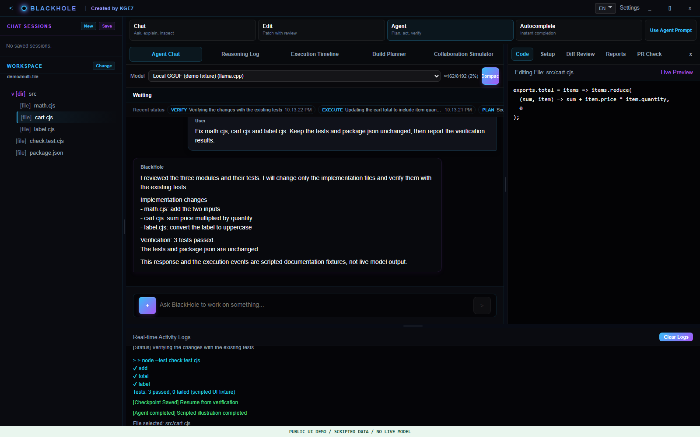
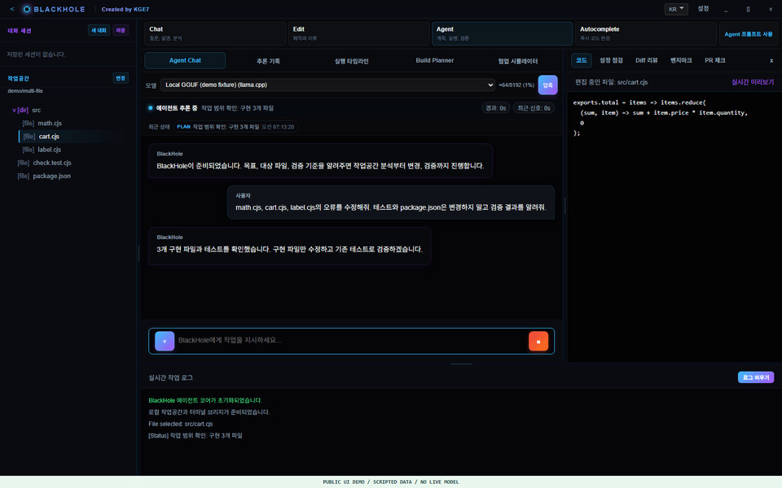
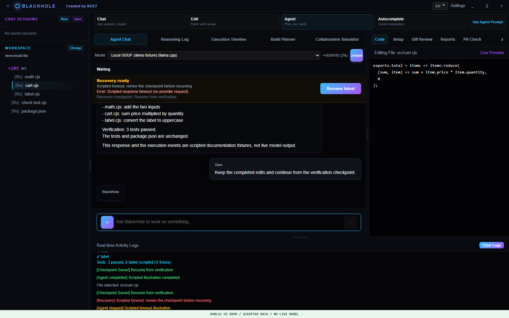
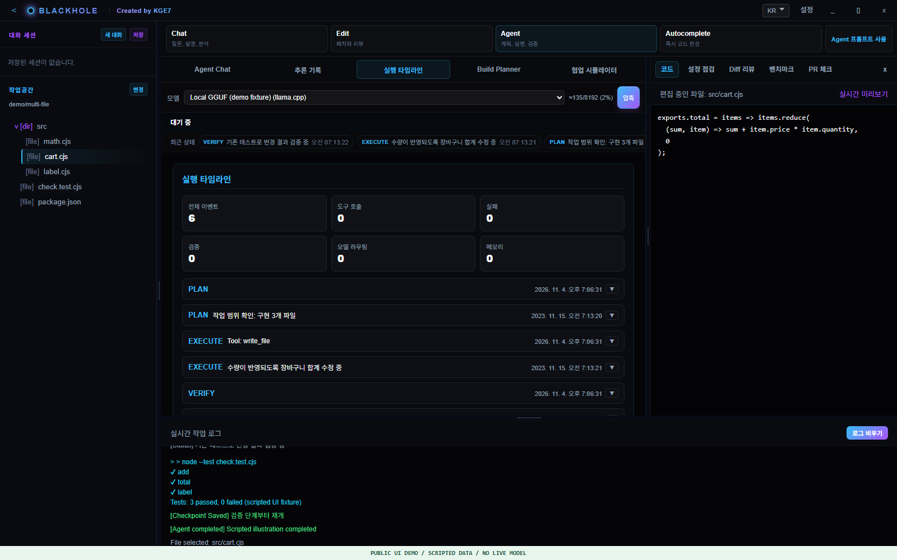
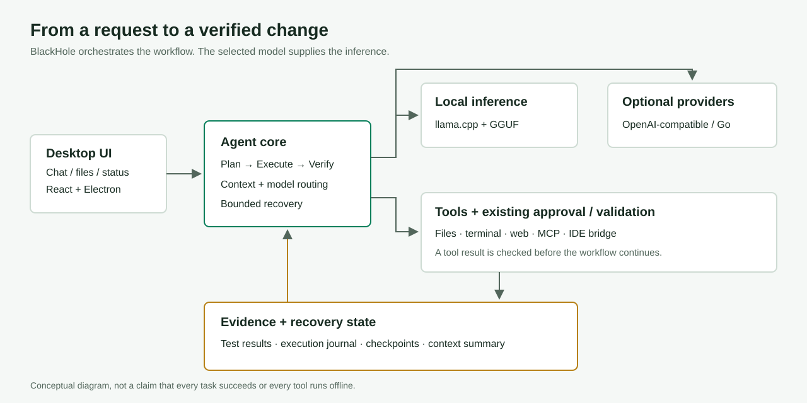

# BlackHole

**A local-first desktop coding agent that plans, edits files, and verifies changes with tests.**

BlackHole connects llama.cpp-based GGUF inference to development tools. Rather
than only suggesting code in a chat, it can work with files and terminal commands,
report execution state, and continue from checkpoints. OpenAI-compatible gateways
and OpenCode Go are optional providers.

[Demo guide](docs/DEMO.md) · [GitHub Pages setup](docs/PUBLISHING.md) · [Developer handoff](blackhole/docs/WALKTHROUGH.md) · [License](LICENSE)

**[Windows development prerelease](https://github.com/ColorlessDigital/BlackHoleAgent/releases/tag/v1.0.0-stabilized.13)**
· **[Project page](https://colorlessdigital.github.io/BlackHoleAgent/)**

Use the Release asset `blackhole.exe` for portable execution. GGUF weights must
be downloaded separately. This is a development prerelease with known dependency
audit findings. `BlackHole-Setup.exe` imports a self-signed CA into the machine
certificate store; read the warnings before choosing Setup.



> **Real frontend, scripted public data.** These screenshots use the actual built
> UI with controlled API/SSE fixtures. Responses and logs are illustrations, not
> live model output or benchmark evidence. No personal conversation, credential,
> user workspace or desktop screenshot was used.

<details>
<summary>Watch the workflow GIF: scripted planning, editing and verification</summary>



</details>

## What Kind of Agent Is It?

BlackHole is an **execution system around a selected model**, not a model trained
by this project. It combines planning, tool execution, verification and reporting,
with context management and explicit recovery state. It is under active
development and does not guarantee automatic resolution of arbitrary tasks.

| Capability | Scope |
|---|---|
| Local GGUF | llama.cpp lifecycle, model selection, GPU/context/output settings |
| Code work | Read and modify files, run terminal commands, validate a project |
| Status and recovery | Progress, heartbeats, execution journal, checkpoints and resume |
| Long conversations | Context budgeting, summarization and compaction |
| Reasoning records | Model-supplied reasoning displayed separately from the answer |
| External tools | Web tools, MCP integration and a companion VS Code extension |
| Optional APIs | OpenAI-compatible gateways and OpenCode Go |

Local model inference runs on the PC. Selecting web tools, MCP services or cloud
providers can involve external communication; not every feature is offline.
Model licenses, provider access and usage charges apply independently.

## Demonstration Examples

### 1. Fix Bugs Across Multiple Files

```text
Fix src/math.cjs, src/cart.cjs and src/label.cjs.
Keep check.test.cjs and package.json unchanged.
Run the existing tests and explain the edits and actual verification results.
```

The [example fixture](examples/multi-file) contains hand-authored before/after
implementations with identical tests and package files. The before version fails
three tests; the after version passes all three. This small reproduction is not
proof that a selected model will solve the task. Follow the [demo guide](docs/DEMO.md#1-multi-file-editing)
to test an agent in an isolated workspace.

### 2. Inspect a Failure and Resume from a Checkpoint



Inspect the cause and available checkpoint, address the underlying issue, and
explicitly resume. This does not promise automatic recovery from every failure
or exactly-once execution of external side effects. [Recovery scope](docs/DEMO.md#2-progress-and-failure-recovery)

### 3. Review the Execution Timeline



Review the process as well as the final answer: plans, tool results, verification
and recovery events. Reasoning records are shown only when a model supplies them;
the application does not invent missing reasoning for display.

## Architecture



| Path | Responsibility |
|---|---|
| `blackhole/src` | Electron app, API, agent, runtimes, tools and tests |
| `blackhole/frontend` | React/Vite interface |
| `blackhole/scripts`, `blackhole/build` | Checks, packaging, installer and signing |
| `blackhole/benchmarks` | Evaluation manifests and fixtures |
| `blackhole/.blackhole` | Source-controlled workspace settings, rules and prompts |
| `vscode-blackhole` | Companion VS Code extension |
| `docs` | Public site, images, demo and publishing guides |

## Start on Windows

Keep the complete source tree together. From its root in PowerShell:

```powershell
powershell -NoProfile -ExecutionPolicy Bypass -File tools/bootstrap-windows.ps1
$env:Path = (Join-Path $PWD 'node-v24.21.0-win-x64') + ';' + $env:Path
Set-Location blackhole
npm run build:frontend
npm start
```

Bootstrap downloads the official Node 24.21.0 and llama.cpp b9553 Vulkan x64
archives, verifies SHA-256, and runs `npm ci` for the application, frontend and
extension using their lockfiles. Downloads and dependency installation require
internet access. **No model or API key is included.**

Download GGUF weights independently, then select the model path and workspace
in Settings. Model size, quantization, RAM/VRAM and configuration determine
whether a model fits and how quickly it runs. Enter provider credentials locally;
never upload them in source, issues or screenshots. Development and packaged
data locations differ, and OS-encrypted credentials are not portable between PCs.

## Checks and Packaging

```powershell
npm test
npm --prefix frontend test
npm run check:backend
npm run check:workspace-rules
npm run release:check -- --skip-extension-e2e
npm run build:windows
```

Release checks have runtime/browser prerequisites. Extension-host E2E, visual
checks and live-model evaluation are separate scopes. The diff step of
`pr:check` needs a Git repository; source archives do not include `.git` history.

**Recorded baseline:** a clean public-source install passed 404 backend tests,
10 frontend tests, frontend build, extension packaging and release checks with
extension-host E2E excluded. These are not general coding benchmark scores or
proof of cross-PC trust, Linux compatibility or unattended durability.
See [PUBLIC_VALIDATION.json](PUBLIC_VALIDATION.json) for scope and warnings.

**Known findings remain:** dependency audits include Critical/High findings.
Preparing or publishing this package does not resolve them. Review versions,
exposure and impact before distributing or deploying it.

**Signing side effects:** the existing Windows build creates or uses a local
self-signed CA/Publisher certificate and trusts the CA in `CurrentUser\Root`.
The installer also performs certificate-store operations. This is not a public
CA publisher identity. Read [the certificate guide](blackhole/docs/ROOT_CA_OPERATIONS.md),
`blackhole/scripts/sign-release.ps1` and `blackhole/build/installer.nsh` first.
No original developer private signing key is distributed.

Linux requires its own host, build and validation. This Windows source snapshot
does not certify Linux/macOS releases.

## License and Public Scope

Copyright 2026 KGE7

Apache-2.0: [LICENSE](LICENSE), [NOTICE](NOTICE). Dependencies, assets and marks
retain their respective terms; see [THIRD_PARTY.md](THIRD_PARTY.md).

The public tree includes source, tests, fixtures, build scripts and lockfiles.
It excludes installed dependencies, runtime binaries, models, original private
Git history, user configuration, credentials, conversations, raw diagnostics and
developer certificates. Public technical summaries and author attribution remain.

This documentation update does not change agent prompts, censorship or approval
policy, runtime behavior, model settings or the previously published executables.
