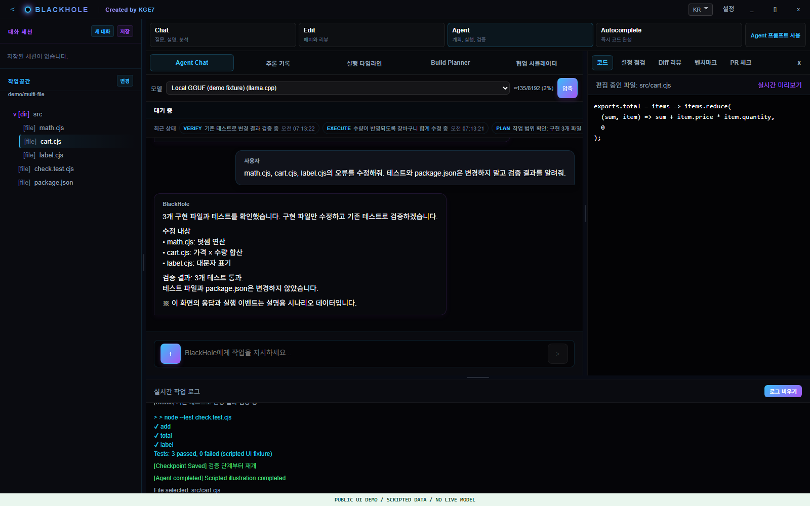
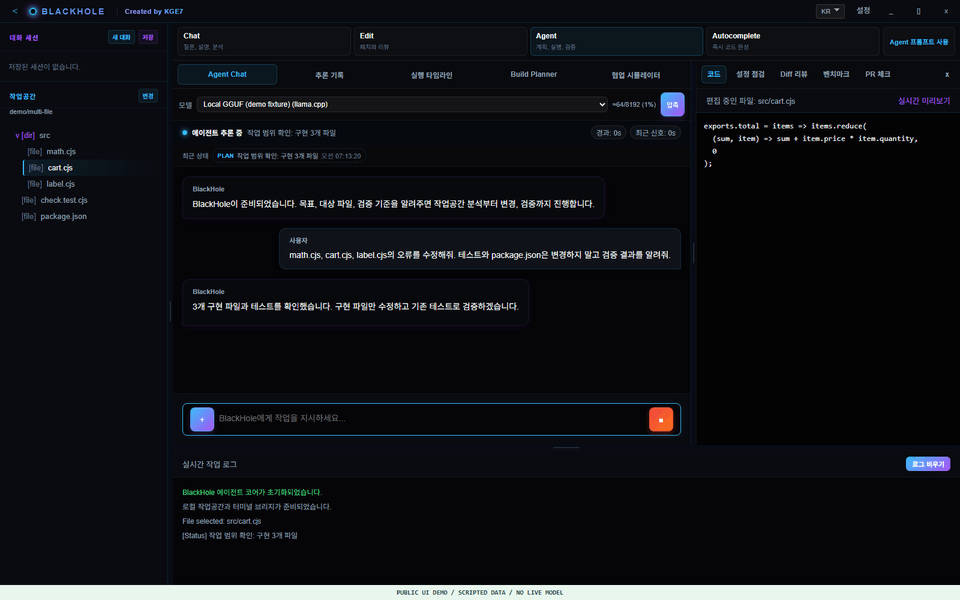
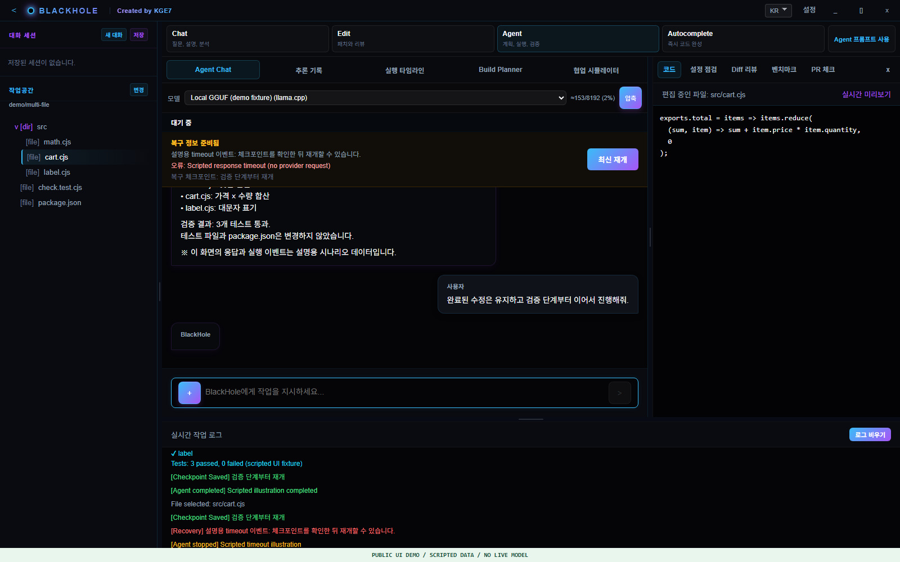
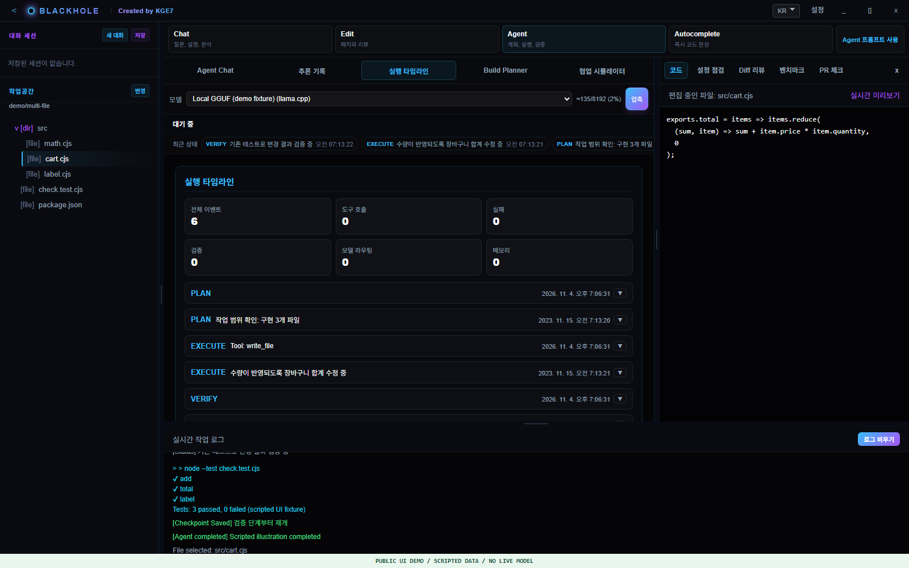
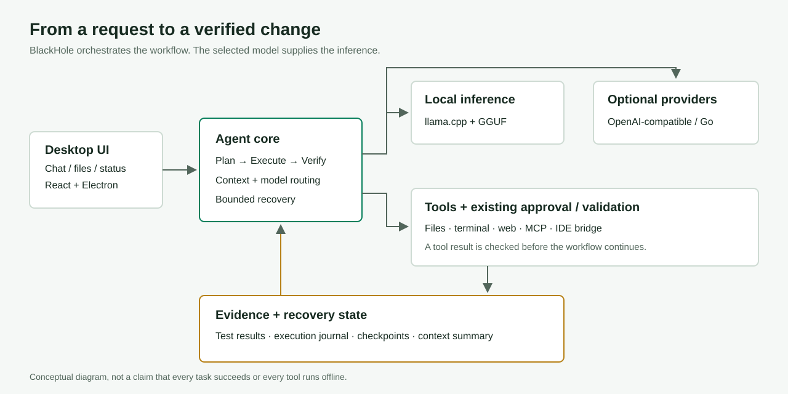

# BlackHole

**로컬 GGUF 모델로 계획하고, 파일을 수정하고, 테스트로 확인하는 데스크톱 코드 에이전트.**

BlackHole은 llama.cpp 기반 로컬 추론과 도구 실행을 연결합니다. 채팅에 코드를 출력하는 데서
그치지 않고 작업공간의 파일·터미널·검증 도구를 사용하며, 실행 상태와 체크포인트를 표시합니다.
OpenAI 호환 게이트웨이와 OpenCode Go는 선택적으로 연결할 수 있습니다.

[English](README.en.md) · [시연 따라 하기](docs/DEMO.md) · [GitHub Pages 안내](docs/PUBLISHING.md) · [라이선스](LICENSE)

**공식 저장소:** [ColorlessDigital/BlackHoleAgent](https://github.com/ColorlessDigital/BlackHoleAgent)

**Windows 개발 빌드:** [v1.0.0-stabilized.13 다운로드](https://github.com/ColorlessDigital/BlackHoleAgent/releases/tag/v1.0.0-stabilized.13)
· [소개 페이지](https://colorlessdigital.github.io/BlackHoleAgent/)

설치 없이 실행하려면 Release의 `blackhole.exe`를 선택하세요. GGUF 모델은 별도로 받아야 합니다.
현재 배포는 개발용 prerelease입니다. 기존 의존성 취약점과 자체 서명 CA의 제약을 아래에서 확인하세요.
`BlackHole-Setup.exe`는 설치 중 시스템 인증서 저장소에 자체 CA를 등록하므로 실행 전에 주의사항을 읽으세요.



> 실제 프론트엔드를 **공개용 가상 데이터**로 촬영한 화면입니다. 응답·로그는 설명용으로 구성했으며,
> 실제 모델의 실행 성공이나 성능 측정 결과가 아닙니다. 개인 대화·키·사용자 작업공간은 사용하지 않았습니다.

<details>
<summary>작업 흐름 시연 GIF 보기 (설명용 이벤트 재생)</summary>



</details>

## 어떤 에이전트인가요?

BlackHole은 자체 학습한 모델이 아니라 **선택한 모델에 개발 도구와 작업 흐름을 연결하는 실행 시스템**입니다.
계획 → 도구 실행 → 검증 → 결과 보고를 조합하고, 실패하면 상태와 복구 지점을 알려줍니다.
현재는 지속적으로 검증·안정화 중인 개발 프로젝트이며, 모든 과제의 자동 해결을 보장하지 않습니다.

| 기능 | 하는 일 |
|---|---|
| 로컬 GGUF | llama.cpp 서버 관리, GGUF 선택, 문맥·출력·GPU 설정 |
| 코드 작업 | 파일 읽기·수정, 터미널 명령, 프로젝트 검증 |
| 상태·복구 | 진행 상태, heartbeat, 실행 원장, 체크포인트·명시적 재개 |
| 긴 대화 | 문맥 예산 관리와 요약·압축 |
| 추론 기록 | 모델이 제공한 추론을 대화 본문과 별도 표시 |
| 외부 도구 | 웹 도구·MCP 및 VS Code 확장 연결 |
| 선택형 API | OpenAI 호환 게이트웨이와 OpenCode Go |

로컬 모델 추론은 PC에서 실행됩니다. 웹·MCP·클라우드 공급자를 선택하면 해당 외부 서비스와
통신할 수 있으므로, 모든 기능이 오프라인이라는 의미는 아닙니다. 모델과 서비스의 라이선스·과금은 별도입니다.

## 시연 예시

### 1. 여러 파일의 버그 수정

```text
src/math.cjs, src/cart.cjs, src/label.cjs의 오류를 수정해줘.
테스트와 package.json은 변경하지 말고 기존 테스트로 검증해줘.
어떤 파일을 왜 수정했는지와 검증 결과를 정리해줘.
```

[예제 소스](examples/multi-file)에는 같은 테스트를 사용하는 수정 전·후 코드가 있습니다.
수정 전은 3개 실패, 수정 후는 3개 통과하는 작은 재현 예제입니다. 모델을 통한 실제 해결 여부는
선택한 모델과 환경에서 별도로 확인해야 합니다. [준비·실행·확인 절차](docs/DEMO.md#1-다중-파일-수정)

### 2. 실패 원인 확인과 체크포인트 재개



실행 중단 시 실패 사유와 복구 상태를 확인하고, 조건을 바로잡은 뒤 체크포인트에서 재개합니다.
모든 오류를 자동 복구하거나 외부 작업의 중복 실행을 완전히 방지한다는 뜻은 아닙니다.
[시연 절차와 제한](docs/DEMO.md#2-진행-상태와-실패-복구)

### 3. 실행 과정을 확인하는 타임라인



최종 답변뿐 아니라 계획·도구 실행·검증·복구 상태를 확인할 수 있습니다.
모델이 제공하지 않은 추론을 별도로 만들어 표시하지는 않습니다.

## 구조



| 경로 | 역할 |
|---|---|
| `blackhole/src` | Electron 앱, API, 에이전트, 런타임, 도구·테스트 |
| `blackhole/frontend` | React/Vite 인터페이스 |
| `blackhole/scripts`, `blackhole/build` | 검사·빌드·설치·서명 |
| `blackhole/benchmarks` | 평가용 데이터와 fixture |
| `blackhole/.blackhole` | 소스 관리되는 workspace 설정·규칙·프롬프트 |
| `vscode-blackhole` | VS Code 확장 |
| `docs` | 공개 소개 페이지, 이미지, 시연·게시 안내 |

자세한 개발 구조는 [공개 인수인계 문서](blackhole/docs/WALKTHROUGH.md)를 참고하세요.

## Windows에서 시작하기

소스 전체를 같은 폴더 구조로 준비한 뒤 최상위 폴더의 PowerShell에서 실행합니다.
다운로드·의존성 설치에는 인터넷이 필요합니다.

```powershell
powershell -NoProfile -ExecutionPolicy Bypass -File tools/bootstrap-windows.ps1
$env:Path = (Join-Path $PWD 'node-v24.21.0-win-x64') + ';' + $env:Path
Set-Location blackhole
npm run build:frontend
npm start
```

bootstrap은 공식 Node 24.21.0·llama.cpp b9553 Vulkan x64 배포본의 SHA-256을 확인하고
앱·프론트·확장의 잠금 파일 기준으로 `npm ci`를 수행합니다. **GGUF 모델과 API 키는 포함하지 않습니다.**
모델을 별도로 내려받아 Settings에서 경로와 작업공간을 지정하세요. 모델 실행 가능 여부와 속도는
양자화·모델 크기·RAM/VRAM·설정에 따라 달라집니다.

클라우드 키는 앱 설정에 직접 입력하며 소스·이슈·스크린샷에 올리지 마세요.
개발용 데이터와 패키지 실행 데이터는 구분되며, OS 암호화 키는 다른 PC로 그대로 이전할 수 없습니다.

## 검증과 빌드

```powershell
npm test
npm --prefix frontend test
npm run check:backend
npm run check:workspace-rules
npm run release:check -- --skip-extension-e2e
npm run build:windows
```

릴리스 검사에는 런타임·브라우저 등 추가 조건이 있을 수 있습니다. 확장 host E2E와 실제 모델 평가,
브라우저 시각 검사는 별도 범위입니다. `pr:check`의 diff 검사는 Git 저장소가 필요합니다.

**현재 검증 범위:** 공개 소스 재설치 환경에서 백엔드 404개·프론트 10개 테스트와 프론트 빌드,
확장 패키징·릴리스 검사를 통과했습니다. 확장 host E2E는 제외했습니다. 이는 범용 과제 해결률이나
다른 PC 설치·Linux 호환성·장시간 무인 운용의 보장이 아닙니다. [검증 정보](PUBLIC_VALIDATION.json)

**알려진 제한:** 의존성 감사의 기존 Critical/High 경고가 남아 있습니다. 공개 패키지 작성이
취약점 해소를 의미하지 않습니다. 버전과 영향 범위를 검토한 후 배포하세요.

**서명 주의:** 기존 Windows 빌드 스크립트는 자체 CA/Publisher 인증서를 만들거나 사용하며
`CurrentUser\Root`에 CA를 신뢰 등록합니다. 설치 스크립트에도 인증서 신뢰 작업이 있습니다.
이것은 공개 CA의 코드 서명이 아닙니다. [인증서 안내](blackhole/docs/ROOT_CA_OPERATIONS.md)와
실제 `sign-release.ps1`·`installer.nsh`를 먼저 확인하세요. 원 개발자의 인증서·개인키는 포함하지 않습니다.

Linux는 Linux 호스트에서 별도로 빌드·검증해야 합니다. 이 소스 공개본은 Linux/macOS 릴리스 인증이 아닙니다.

## 공개 범위와 라이선스

Apache-2.0: [LICENSE](LICENSE), [NOTICE](NOTICE). 제3자 구성요소·자산·상표는 각자의 조건을
유지합니다. [THIRD_PARTY.md](THIRD_PARTY.md)

소스·테스트·fixture·빌드 스크립트·잠금 파일을 포함합니다. 모델, 설치된 의존성, 런타임 바이너리,
Git 이력, 사용자 설정·키·대화·진단 원본과 개발자 인증서는 제외했습니다. 공개용 기술 요약과
작성자 표시는 남아 있습니다. 화면의 예제 데이터는 설명 목적으로 작성됐습니다.

README는 저장소 첫 화면에, `docs/index.html`은 GitHub Pages용 소개 페이지에 사용할 수 있습니다.
현재 게시 대상은 위 공식 저장소와 소개 페이지입니다. 배포 상태와 파일은 해당 GitHub Release에서 확인하세요.
