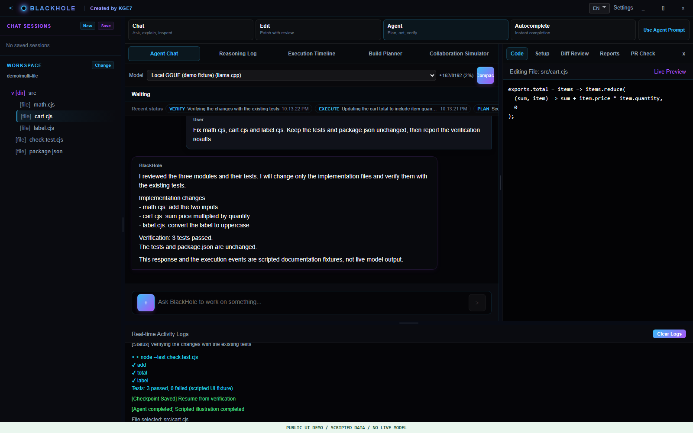
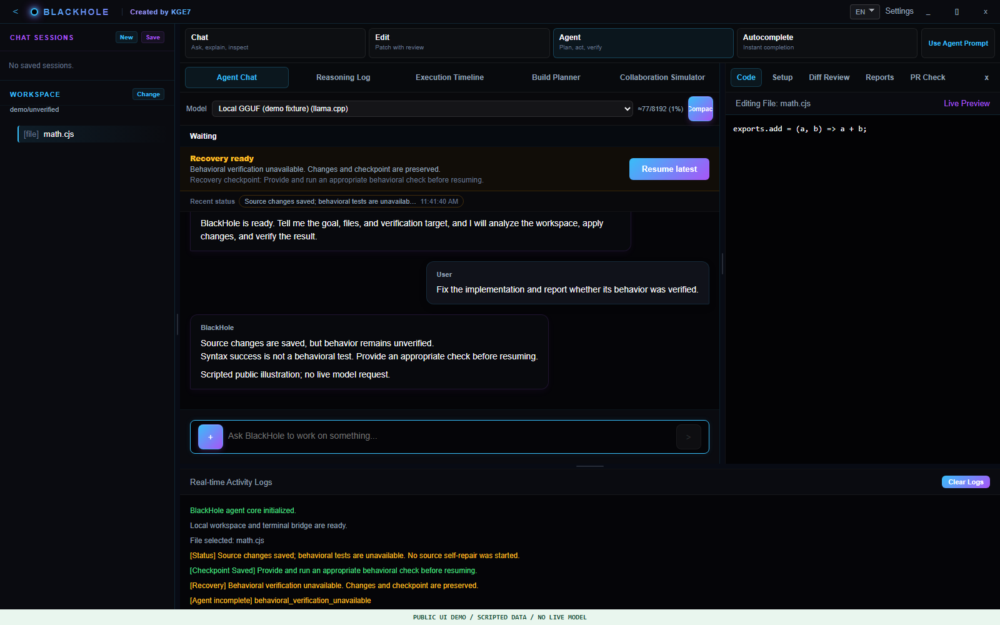
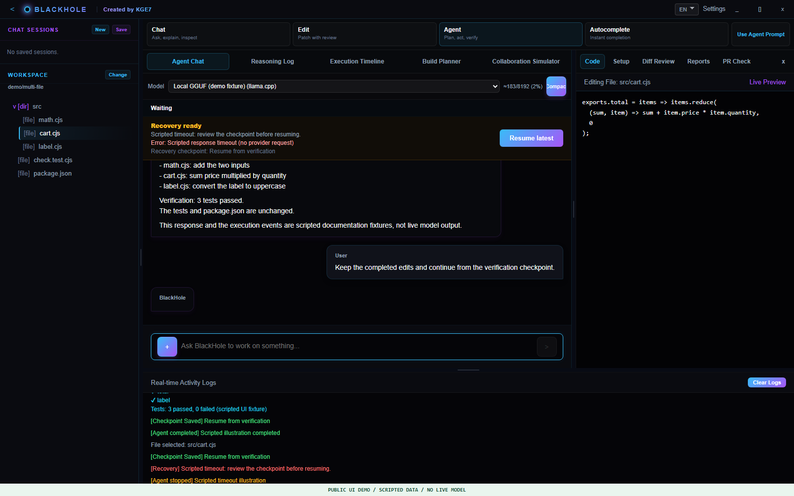
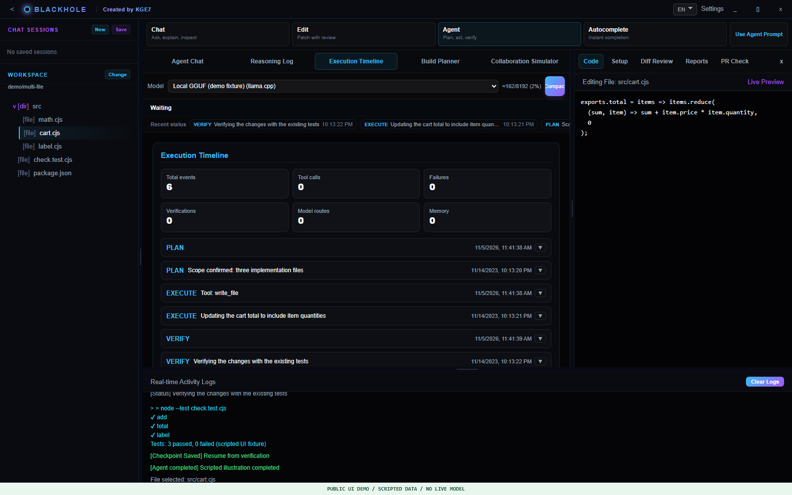

# BlackHole Demo Guide: Stabilized 31

Images/GIF use the real build-31 frontend with scripted public API/SSE fixtures.
They are interface illustrations, not recordings of a real model or timing
measurements. Separate [validation summaries](validation/stabilized-31.json)
describe actual seeded tasks without private transcripts.

## 1. Multi-File Editing

The hand-authored `examples/multi-file/before` and `after` fixtures preserve
identical tests and metadata. From the repository root:

```powershell
node --test examples/multi-file/before/check.test.cjs
# Intentional: 3 failures, exit 1
node --test examples/multi-file/after/check.test.cjs
# Expected: 3 passes, exit 0
```

Copy the whole before folder to an isolated workspace. Select it in the app and ask:

```text
Fix src/math.cjs, src/cart.cjs and src/label.cjs.
Keep check.test.cjs and package.json unchanged.
Run the existing tests and report the actual verification results.
```

Inspect file changes, test/package hashes and an independent fresh-process test run.
A model's claim is not verification. Outcome depends on the model and environment.



## 2. Behavioral Verification Unavailable

Create a separate small workspace containing only a source implementation, with
no test script or applicable existing test. Ask for an implementation fix.

For supported source types, syntax success alone now leaves saved changes with
`incomplete / behavioral_verification_unavailable`. This is not an assertion
failure or a request to rewrite unrelated files. Supply a suitable behavioral
check, then resume the saved checkpoint. The product does not force extra test
files into a workspace just to claim completion.



## 3. Failure and Repair

The packaged model-free regression suite intentionally provides syntax-valid but
behaviorally wrong JavaScript and immutable existing Node assertions. It verifies
that a failed test leads to bounded repair and then a real test rerun.

With a prepared development Electron runtime, from `blackhole`:

```powershell
$release = '<complete-release-folder>'
$label = 'behavior-demo-' + (Get-Date -Format 'yyyyMMdd-HHmmss')
$env:ELECTRON_RUN_AS_NODE = $null
$p = Start-Process -FilePath 'node_modules/electron/dist/electron.exe' -ArgumentList @(
  'scripts/stability-behavior.cjs', "--release=$release", "--label=$label"
) -WindowStyle Hidden -Wait -PassThru
if ($p.ExitCode -ne 0) { throw 'Inspect data/diagnostics/<label>/report.json' }
```

The suite's model responses are scripted, but it uses the packaged executor and
default VerificationEngine. Nine passing scenarios include correctly stopped
unverified work; they do not mean nine normally completed coding tasks.

Actual live build31 tasks separately completed Go 8/8 and local 4B coding 3/3
with immutable tests. They are small seeded tasks, not a universal benchmark.

## 4. Progress, Interruption and Resume



Check cause, partial output, routed model/budget and checkpoint availability.
Address the underlying provider/setup/verification issue before resuming.
Do not replay a finished external effect blindly. Exactly-once external execution
and automatic recovery from every failure are not guaranteed.



Model-supplied reasoning is separate from the answer and is absent when the model
does not supply it. The application does not invent reasoning for display.

## 5. Conversations and Workspace Resources

Background indexing has file/depth/time budgets. Four recent context engines are
kept under strong cache ownership, with weak sharing for active callers. This is
not a total-RAM limit or a restriction on explicit file access.

Build30's historical natural-GC hour passed 553/553; no build31 hour is claimed.
Keep package hashes, budgets and first failures separate when reproducing tests.

## Reproduce Public Images

Build the frontend and install the pinned Playwright headless browser if needed:

```powershell
Set-Location blackhole
npm run build:frontend
node node_modules/playwright/cli.js install chromium --only-shell
Set-Location ..
node tools/capture-docs.mjs
```

Capture uses English fixture data, a headless browser, blocked external requests
and no user credentials or desktop interaction. The GIF is a sequence of the same
documented frames, not a real inference video. [Provenance](images/README.md).
